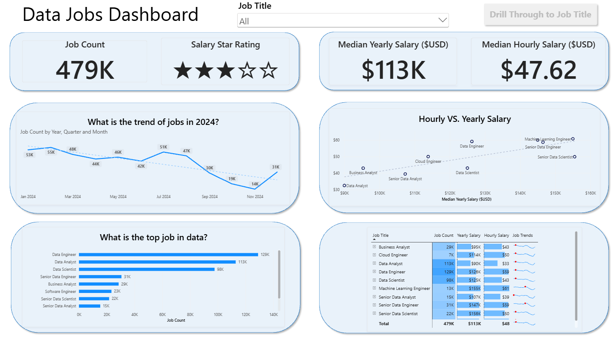
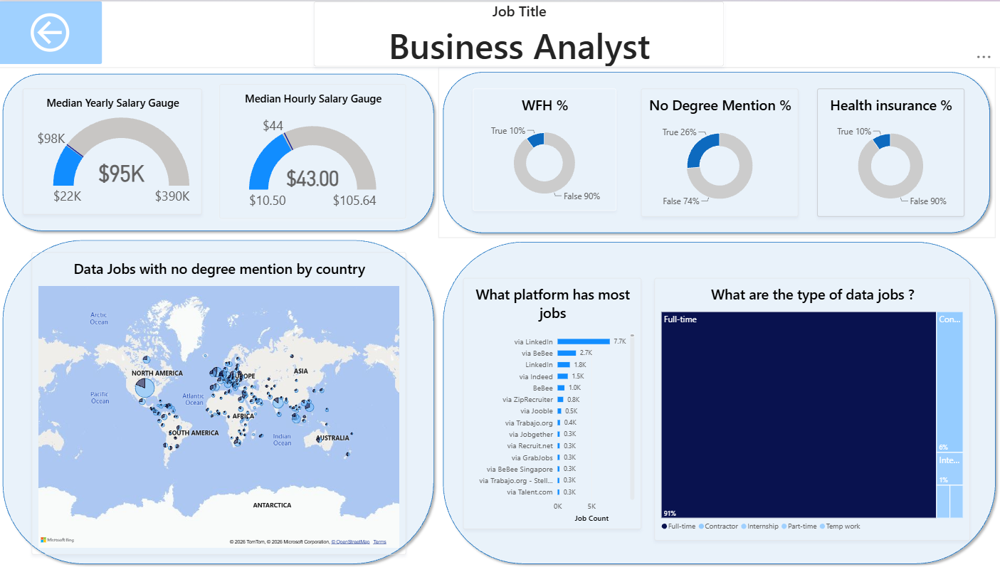

# Data Jobs Dashboard | Power BI

## Introduction

Navigating the data job market can be challenging, especially when information about salaries, job opportunities, qualifications, and employment benefits is scattered across multiple platforms.

This project was developed to help **job seekers, career transitioners, and data professionals** better understand the data job market and make more informed career decisions.

Using a real-world dataset of **2024 data job postings**, I developed an interactive, two-page Power BI dashboard that transforms raw job posting data into meaningful and accessible insights. The dashboard enables users to explore job market trends, compare salaries, identify in-demand roles, and evaluate employment opportunities across different locations.

## Skills Showcased

Throughout this project, I applied a range of Power BI features and data analytics techniques, covering the entire process from data preparation to interactive reporting.

- **Data Transformation (ETL) with Power Query:** Cleaned, transformed, and prepared raw data for analysis by handling missing values, adjusting data types, and creating new columns.
- **Implicit Measures & Data Aggregation:** Used Power BI's built-in aggregation functions to calculate key metrics such as median yearly salary, median hourly salary, and job count.
- **Data Visualization:** Utilized bar charts, line charts, scatter plots, donut charts, and treemaps to communicate market trends, salary comparisons, and employment characteristics.
- **Geospatial Analysis:** Leveraged map visualizations to explore the geographical distribution of job opportunities and degree-related information across countries.
- **KPI Indicators & Matrix Tables:** Used cards, salary gauges, matrix tables, and sparklines to present key performance indicators and detailed market trends.
- **Dashboard Design & Data Storytelling:** Designed a structured, visually appealing, and user-friendly interface that transforms complex data into easily understandable insights.
- **Interactive Reporting:**
    - **Slicers:** Enable users to dynamically filter the report by job title.
    - **Buttons & Bookmarks:** Provide a smoother and more intuitive navigation experience.
    - **Drill-Through:** Allow users to transition from a high-level market overview to a detailed analysis of a specific job role.

## Dashboard Overview

The report is divided into two complementary pages, allowing users to explore the data job market from both a broad and a role-specific perspective.

### Page 1: High-Level Market Overview

This page serves as the central overview of the data job market, providing a snapshot of job demand and compensation trends throughout 2024.

It helps answer key questions such as:

- Which data-related job titles are most in demand?
- How did job posting volumes evolve throughout 2024?
- How do median hourly and yearly salaries compare across different roles?
- How does demand for individual job roles change over time?

Through interactive visualizations, KPI cards, and a detailed matrix, users can quickly identify market patterns and compare different career opportunities.

### Page 2: Job Title Drill-Through

This page provides a deeper analysis of individual job titles, allowing users to move beyond general market trends and explore the characteristics of a specific role.

The detailed analysis includes:

- **Salary Analysis:** Median hourly and yearly salaries, supported by salary range gauges.
- **Remote Work Opportunities:** Percentage of job postings offering work-from-home opportunities.
- **Educational Requirements:** Percentage of job postings that do not explicitly mention a degree.
- **Employment Benefits:** Percentage of job postings mentioning health insurance.
- **Employment Types:** Distribution of job opportunities by employment schedule.
- **Job Platforms:** Identification of platforms with the highest number of job postings.
- **Geographical Distribution:** Exploration of job opportunities and degree-related information across countries.

This page helps users evaluate potential career paths based not only on compensation but also on flexibility, accessibility, benefits, and geographical opportunities.

## Conclusion

This project demonstrates how Power BI can transform raw job posting data into an interactive and practical decision-making tool.

Beyond developing my technical skills in data transformation, visualization, and interactive reporting, this project strengthened my ability to approach real-world business problems through data analytics and effective data storytelling.

Ultimately, the dashboard empowers users to better understand the data job market, evaluate career opportunities, and make more informed professional decisions.

## Tools & Technologies

- Microsoft Power BI Desktop
- Power Query
- Data Transformation (ETL)
- Data Visualization
- Business Intelligence & Data Analytics